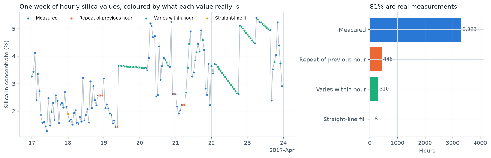
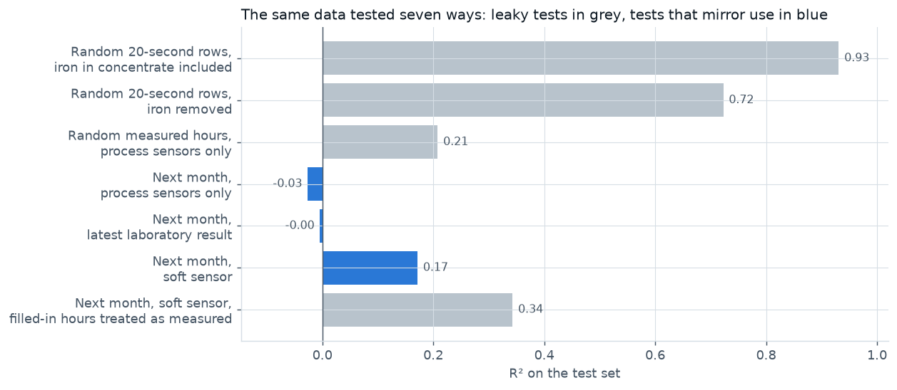
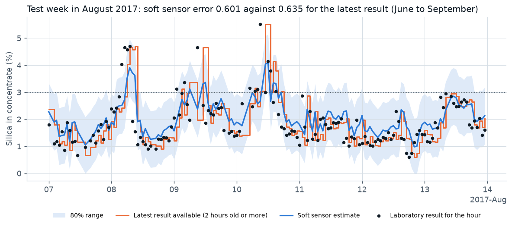
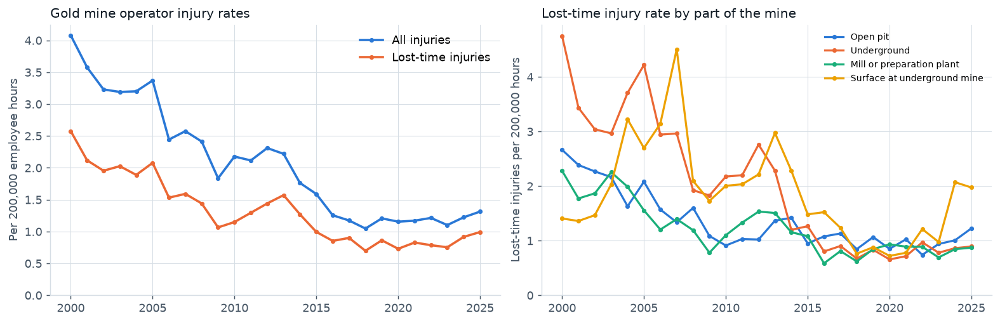
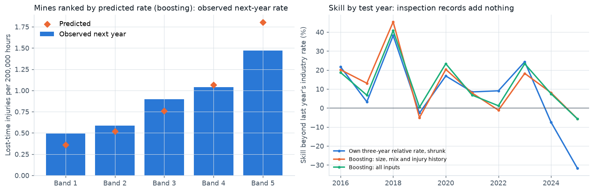

# Mine operations analytics

Two operational questions answered from public mining data. In a processing plant: can the data be trusted, and can concentrate quality be estimated between laboratory results? Across United States gold mines: where do injuries come from, and do inspection records point to the mines most at risk next year?

**[Interactive dashboard](https://onyichuks.github.io/mine-operations-analytics/)** · [Executive summary](docs/EXECUTIVE_SUMMARY.md) · [Research report](docs/REPORT.md) · [Machine learning note](docs/ML_TECHNICAL_NOTE.md) · [About the data](docs/DATASET.md)

## Objective

Build the analysis an operations technology team needs before it trusts a model:
* an audit of plant data that separates real measurements from repeated, interpolated and frozen values;
* a soft sensor for silica in concentrate, judged against the latest laboratory result rather than against R²;
* safety and compliance analytics from United States Mine Safety and Health Administration (MSHA) records for gold mines, 2000 to 2025 (589 mines reported hours, about 150 a year), and a test of whether inspection records are a leading indicator of injuries.

Every model is tested on months or years it never saw, against the simple method an operation already uses.

## Results

| | Result |
|---|---|
| Plant data trust | Only **81%** of hourly silica values are confirmed as new laboratory measurements; two air flow sensors frozen for **460 hours**; feed assays change only every 9 hours |
| The usual test on this dataset | R² **0.93** with shuffled 20-second rows and iron in concentrate as an input (leakage); **-0.03** for the process sensors alone on next month's measured hours |
| Treating filled-in values as measurements | Training and scoring the soft sensor with repeated and interpolated hours treated as real doubles its apparent R² (0.34 against **0.17** on measured hours) |
| Silica soft sensor, June to September 2017 | Error **5%** below the latest laboratory result with a 2-hour turnaround, **16%** below at 6 hours; **81%** of results inside the 80% range |
| What drives the soft sensor | Laboratory history. Compared like for like, the process sensors add nothing at 1 to 2 hours and 2 to 3% at 6 to 12 hours, probably partly because operators adjust them in response to results |
| Gold mine lost-time injury rate | 2.58 per 200,000 hours (2000) to 0.70 (2018), back up to **0.99** (2025); median days away or restricted per injury 15 (2016 to 2020) to **24** (2021 to 2025) |
| Causes | Handling materials and slips or falls are 65% of lost-time injuries (2016 to 2025); powered haulage caused **21 of 48** deaths (2000 to 2025); a third of injured workers had been at the mine less than a year |
| Next-year injury rate model, 2016 to 2025 | Beyond last year's industry rate, a mine's own recent rate explains **10%** of the variation and the best models **13 to 15%**; inspection and violation records add **nothing** (0.0 points, 90% interval -1.9 to +2.1); the fifth of mines ranked highest by gradient boosting had **1.8 times** the average rate the next year |

The [machine learning note](docs/ML_TECHNICAL_NOTE.md) covers how both models were framed and checked: leakage controls, tuning on a month that is never scored, training and learning curves, baselines with the same inputs, calibration, importance, and two early versions of the injury model that were corrected.







## Conclusions

1. **Audit plant data before modelling it.** Nearly a fifth of the hourly laboratory values in this dataset are not new measurements, and treating them as real doubles a model's apparent R².
2. **The latest laboratory result is the benchmark.** The soft sensor is worth running when results are late. With a fresh result, a faster laboratory turnaround is worth more than a model.
3. **Treat fatal risk separately from injury counts.** Powered haulage is under a tenth of lost-time injuries but 44% of deaths, and the most cited standards point at the same hazards (equipment defects, ground conditions, safe access).
4. **Use a mine's own recent injury rate, relative to the industry, to decide where to look first.** Citation counts add nothing once that is known. The signal is modest and varies from year to year, so any ranking should be refitted every year.

## Repository

```
src/mineops/         data loading, plant data checks, plant performance indicators, soft sensor, injury rates,
                     inspections and violations, injury rate model, JSON output helpers
scripts/             get_data, prepare_data, build_dashboard, make_figures
run_plant.py         plant data audit, performance indicators and the soft sensor (monthly rolling test)
run_safety.py        injury rates and causes, inspections and violations, injury rate model (yearly rolling test)
outputs/             results (.json) and tables (.csv)
dashboard/, docs/    dashboard template; built dashboard (GitHub Pages), report, summary, machine learning note, data notes
figures/             static charts for this page and the report
tests/               unit tests (pytest)
```

## Reproduce

```
pip install -r requirements.txt
python scripts/get_data.py           # about 330 megabytes from OpenML and MSHA
python scripts/prepare_data.py       # converts the plant file and extracts the gold mine records
python run_plant.py                  # about 2 minutes
python run_safety.py                 # under a minute
python scripts/build_dashboard.py
python scripts/make_figures.py
pytest
```

The raw files are not stored here; `get_data.py` downloads them and checks their SHA-256 checksums. MSHA refreshes its files every Friday, so a fresh download moves the safety numbers slightly (the results here use the 27 October 2026 files). The published results were produced with scikit-learn 1.6.1; newer versions change the gradient boosting scores slightly without changing the conclusions.

## Data and use

Plant data: "Quality Prediction in a Mining Process", OpenML dataset 43311, CC0 public domain dedication. Safety data: MSHA Open Government Data, public domain. This is an independent project, not affiliated with or endorsed by MSHA or the data publishers. Code is under the MIT License.
