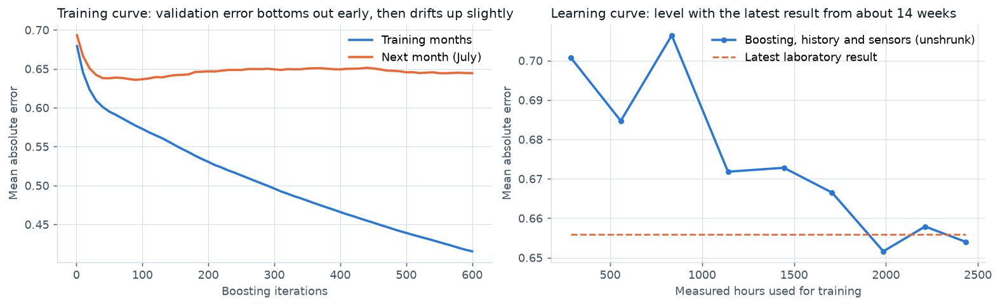

# Machine learning technical note

How the two models in this project were framed, trained, validated and checked, including what did not work. Results come from `run_plant.py` and `run_safety.py`; most tables here are also in `outputs/tables/`, and the rest are in `outputs/plant_results.json` and `outputs/safety_results.json`.

[Report](REPORT.md) · [Executive summary](EXECUTIVE_SUMMARY.md) · [About the data](DATASET.md) · [Dashboard](https://onyichuks.github.io/mine-operations-analytics/)

## Summary

| | Soft sensor (silica in concentrate) | Injury rate model (gold mines) |
|---|---|---|
| Unit | One measured laboratory hour | One mine and year |
| Target | Silica result for the hour (%) | Next year's lost-time injuries, with next year's hours as exposure, relative to the industry rate |
| Algorithm | Gradient boosting (scikit-learn `HistGradientBoostingRegressor`) on the change from the latest result, shrunk toward it | Gradient boosting with Poisson loss; Poisson regression for comparison |
| Benchmark | The latest laboratory result that has arrived | Last year's industry rate; the mine's own three-year relative rate, shrunk |
| Validation | Monthly rolling origin, June to September 2017 (1,996 hours) | Yearly rolling origin, 2016 to 2025 (769 mine-years) |
| Main score | Mean absolute error 0.601 against 0.635 (5.4% lower, 2-hour turnaround) | Deviance skill 13.3% (boosting) and 14.6% (Poisson regression) against 10.1% for the simple rule |
| Uncertainty | Split conformal 80% range: 81.2% coverage | 90% intervals on skill differences from a clustered bootstrap by mine |
| What the inputs add | Laboratory history carries the signal; like for like, process sensors add nothing at 1 to 2 hours and 2 to 3% at 6 to 12 hours | Injury history and size carry the signal; inspection and violation records add nothing |

---

## Part 1. Soft sensor for silica in concentrate

### 1.1 Framing

A soft sensor is only useful if it is better than what the control room already has. Between laboratory results, that is the latest result that has arrived. The model is therefore framed around the laboratory turnaround:

* the result for hour t arrives `delay` hours after the hour ends (2 hours in the central case, 1 to 12 hours in the sweep);
* at that time the soft sensor estimates silica for hour t from the process sensors for hours up to t and from laboratory results that have already arrived;
* the target is the measured silica result for hour t.

Gradient boosting predicts the change from the latest available result, not the level. The estimate is then the latest result plus a share w of that predicted change. w is chosen from 0, 0.1, ..., 1 on the previous month, so the model falls back toward the latest result when its corrections stop helping.

### 1.2 Inputs

| Group | Features |
|---|---|
| Process sensors (19 tags) | For each tag: hourly mean, within-hour standard deviation, change from the previous hour, three-hour rolling mean (76 features) |
| Feed assays | Iron and silica in feed (hourly mean) |
| Laboratory history | Latest available measured result; mean of the measured results in the last six available hours; age of the latest result (hours); latest change between two results |

### 1.3 Leakage controls

Each of these was found in the data audit, and each would inflate the score if left in place.

1. **Iron in concentrate is never an input.** It is assayed from the same sample as silica (correlation -0.80).
2. **Only measured hours are targets.** Repeated hours (446), hours interpolated within the hour (310) and straight-line fills (18, possibly real but excluded to be safe) are not scored.
3. **Only measured results are laboratory history.** An interpolated value can be built from a later result, so it would carry the future into the inputs. A unit test (`test_lab_history_never_looks_ahead`) checks that the latest result used as history is at least `delay` hours old and never a repeat.
4. **Frozen data is blanked.** The two air flows stuck for 460 hours are set to missing, and so are eight hours when the data feed stalled (nearly every sensor frozen, or a quarter or more of the rows exact copies). Gradient boosting handles missing values natively; the ridge baseline uses training medians.
5. **Splits are by time, never by row.** Shuffled 20-second rows put near-copies of the same hour in training and test sets (section 1.12).

### 1.4 Validation design

| Step | Data |
|---|---|
| Hyperparameter search | Train March and April, validate May |
| Test months | June, July, August, September (to the 9th) |
| For each test month | Train on all measured hours before the month |
| Shrinkage share w and 80% range | Set on the previous month's predictions, made by the model trained before that month |
| Warning threshold | Set on the previous month (the threshold with the best F1 score, the balance of precision and recall) |

Nothing is tuned on a month that is then scored. May is used for tuning and also as the calibration month for June. June's share and range therefore come from errors on the month the hyperparameters were chosen on, which is slightly optimistic for June only.

### 1.5 Hyperparameters

A grid of 36 settings was tried on May (learning rate 0.03 or 0.06; 7, 15 or 31 leaves per tree; minimum leaf size 20, 40 or 80; L2 regularization penalty, a penalty on the squared size of the leaf values, 0 or 1), with 300 iterations.

| Learning rate | Leaves | Minimum leaf size | L2 penalty | May mean absolute error |
|---:|---:|---:|---:|---:|
| **0.03** | **7** | **80** | **1.0** | **0.742** |
| 0.03 | 15 | 80 | 1.0 | 0.743 |
| 0.03 | 31 | 80 | 1.0 | 0.743 |
| 0.03 | 15 | 80 | 0.0 | 0.744 |
| 0.06 | 15 | 40 | 0.0 | 0.834 (worst) |

Heavy regularization (a large minimum leaf size, small trees and slow learning) wins clearly, which fits a weak signal. The chosen model was worse than the latest result on May itself (0.742 against 0.691). It had only about 700 training hours, and the learning curve below shows it needs more. The shrinkage step protects against this: w is chosen on the previous month, so a weak model is pulled toward the latest result.

### 1.6 Training curve

Trained on March to June and validated on July, with 600 iterations and no early stopping (`p11_training_curve.csv`):

* validation error falls from 0.693 to its lowest, 0.636, at about 90 iterations;
* it then drifts up slightly, to 0.649 at 300 and 0.644 at 600;
* training error keeps falling, from 0.68 to 0.42.

The model overfits mildly after about 90 iterations. The production setting keeps 300 iterations because that is what was tuned on May. Choosing the iteration count on July would have been tuning on a test month. The cost is about 2 percent on July, inside the month-to-month variation. Early stopping chosen on the calibration month is the next refinement to try.

### 1.7 Learning curve

The test set is August and September; training uses the last k weeks before 1 August (`p10_learning_curve.csv`). The model here is unshrunk boosting on history and sensors.

| Weeks of history | Training hours | Training error | Test error | Latest result |
|---:|---:|---:|---:|---:|
| 2 | 285 | 0.517 | 0.701 | 0.656 |
| 6 | 835 | 0.404 | 0.706 | 0.656 |
| 10 | 1,445 | 0.402 | 0.673 | 0.656 |
| 14 | 1,986 | 0.468 | 0.652 | 0.656 |
| 18 | 2,434 | 0.500 | 0.654 | 0.656 |

The unshrunk model needs about 14 weeks (2,000 measured hours) to match the latest result, and test error is flat from there (0.652, 0.658 and 0.654 at 14, 16 and 18 weeks). More history of the same kind is unlikely to help much; better information is needed (section 1.13).

### 1.8 Results by model

Pooled over June to September, 2-hour turnaround (`p07_soft_sensor_scores.csv`):

| Model | Mean absolute error | Root mean square error | R² | Bias |
|---|---:|---:|---:|---:|
| Latest laboratory result | 0.635 | 0.948 | 0.00 | +0.018 |
| Training average | 0.802 | 0.980 | -0.07 | +0.212 |
| Ridge regression, process sensors only | 0.778 | 0.995 | -0.11 | +0.060 |
| Gradient boosting, process sensors only | 0.749 | 0.958 | -0.03 | +0.093 |
| Gradient boosting, laboratory history only | 0.610 | 0.819 | 0.25 | +0.081 |
| Gradient boosting, history and sensors | 0.618 | 0.828 | 0.23 | +0.086 |
| Laboratory history only, shrunk | 0.602 | 0.865 | 0.16 | +0.037 |
| **Soft sensor (history and sensors, shrunk)** | **0.601** | 0.861 | 0.17 | +0.044 |

* The two models without laboratory history are well behind the latest result and close to the training average.
* The shrunk models have the lowest mean absolute error. The unshrunk boosting models have lower root mean square error and higher R²: they make fewer large misses but more small ones.
* Shrinkage halves the bias.

The shares chosen were 0.3 (June), 0.4 (July), 0.7 (August) and 0.5 (September). The soft sensor beat the latest result in every month: June 0.535 against 0.551, July 0.651 against 0.697, August 0.590 against 0.626 and September 0.699 against 0.751.

### 1.9 Calibration of the 80% range

The range is the soft sensor estimate plus or minus the conformal quantile of the previous month's absolute errors (the value at rank ceil((n + 1) × 0.8) of n errors), floored at zero.

| Month | Coverage | Mean width (percentage points) |
|---|---:|---:|
| June | 87.4% | 2.20 |
| July | 73.9% | 1.72 |
| August | 84.5% | 2.10 |
| September | 73.4% | 1.87 |
| All | 81.2% | 1.99 |

Coverage is right overall and at every turnaround (80.3 to 81.5 percent). Month by month it moves with volatility: a calm month calibrates a narrow range that a volatile month then exceeds. Width conditioned on recent volatility, for example from conformalized quantile regression, would even this out.

### 1.10 What the model relies on

The error increase when each group of the model's inputs is shuffled within each test month (five repeats; `p08_grouped_importance.csv`). The latest result that the estimate is built on is kept fixed, so this measures what the model learned, not the loss of the latest result itself.

| Group | Increase in mean absolute error |
|---|---:|
| Laboratory history | 0.083 |
| Column air flows | 0.002 |
| Ore pulp (flow, pH, density) | 0.001 |
| Column levels | 0.000 |
| Feed assays | 0.000 |
| Reagents (starch, amine) | -0.001 |

The like-for-like comparison agrees. Both models below are shrunk toward the latest result in the same way (`p09_turnaround_sweep.csv`):

| Turnaround (hours) | 1 | 2 | 3 | 4 | 6 | 8 | 12 |
|---|---:|---:|---:|---:|---:|---:|---:|
| History only, shrunk | 0.504 | 0.602 | 0.657 | 0.705 | 0.747 | 0.772 | 0.792 |
| History and sensors, shrunk (soft sensor) | 0.506 | 0.601 | 0.649 | 0.698 | 0.727 | 0.755 | 0.769 |
| What the sensors add | -0.3% | 0.2% | 1.2% | 1.1% | 2.7% | 2.2% | 2.9% |

The process sensors matter only once the latest result is a few hours old. Most of the skill is a better use of the laboratory history: silica reverts toward its recent average, and a six-hour mean and the age of the result capture that. Part of the reason the sensors add so little is probably that operators adjust them in response to results (amine flow tracks the result from three hours earlier), so they partly repeat what the history already says.

### 1.11 Off-specification warning

`HistGradientBoostingClassifier`, same inputs and settings, target "silica above 3 percent". The test period had 14.7 percent of hours off specification.

| | Model | Latest result as a score | Process sensors only |
|---|---:|---:|---:|
| Area under the receiver operating characteristic curve | 0.74 | 0.76 | 0.62 |
| Average precision | 0.36 | 0.41 | 0.20 |
| Catch rate at the chosen threshold | 46% | 58% | |
| False alarms among warnings | 65% | 66% | |
| Brier skill against the base rate | 17% | | |

The classifier adds nothing over a threshold on the latest result, so it is reported but not recommended.

### 1.12 How the usual test overstates accuracy

`softsensor.leakage_demo` scores the same data seven ways (200,000 sampled rows for the first two):

| Test | R² | Mean absolute error |
|---|---:|---:|
| Random split of 20-second rows, all columns including iron in concentrate | 0.931 | 0.212 |
| Random split of 20-second rows, iron removed | 0.723 | 0.435 |
| Random split of measured hours, process sensors only | 0.208 | 0.692 |
| Next month, measured hours, process sensors only | -0.027 | 0.749 |
| Next month, latest laboratory result | -0.004 | 0.635 |
| Next month, soft sensor | 0.172 | 0.601 |
| Next month, soft sensor, every hour with a value treated as measured | 0.343 | 0.553 |

The first three rows each keep one shortcut:

1. Iron in concentrate is a second reading of the same sample.
2. Random 20-second rows share hours, and so share laboratory values, between training and test sets.
3. Random hours share days and operating conditions between training and test sets.

Rows four to six describe how a model would perform in the plant. The last row uses the same model and test months but treats repeated and interpolated hours as measurements, both as targets and as history: its R² doubles.

### 1.13 What would improve it

* Early stopping on the calibration month.
* Intervals whose width follows recent volatility.
* Sample times and analyzer status from the laboratory system, so the turnaround is known hour by hour rather than assumed.
* Tags that describe the froth directly (froth camera speed and bubble size), which carry more information about grade than flows and levels, or an online analyzer.

---

## Part 2. Next-year injury rate model for gold mines

### 2.1 Framing, and two early versions that were corrected

**First version: a classifier.** The first exploratory version (not kept in the code) predicted whether a mine would have any lost-time injury next year. With mines of 10,000 hours or more, 46 percent of test mine-years had one. Size alone gave an area under the curve of 0.88 (logistic regression on hours and workforce mix), and adding everything else gave 0.87 to 0.89. That model mostly learned that big mines have injuries, which a safety team already knows.

**Second version: a rate model with the wrong baseline.** The next version predicted the injury rate, with hours as exposure. Its baseline was the average rate over all earlier years, and it learned absolute rates. Injury rates fell steeply from 2000 to 2018, so that baseline was about 20 to 100 percent too high, about 60 percent in a typical test year. Every model beat it easily, and skill scores came out near 30 percent. Measured against last year's industry rate, the same models scored 9 to 13 percent.

**Final version.** The final version removes the industry trend:

* **Target.** Next year's lost-time injury count, with next year's hours as the exposure.
* **Relative rate.** The count is expressed against what the mine would have had at that year's industry rate. Models are fitted on this relative rate, with the expected count as the sample weight. That is equivalent to a Poisson model with a log-expected-count offset.
* **Prediction.** Predicted relative rates are converted back to rates with last year's industry rate, the latest figure known when the prediction is made.
* **Baseline.** Last year's industry rate for every mine. Skill above zero therefore means the model separates high-rate from low-rate mines; it is not credited for knowing mine size or the industry trend.

Using next year's hours as exposure assumes the planned hours are known in advance, which is reasonable for a mine with a production plan.

### 2.2 Panel and leakage controls

* **Rows.** Each row is a mine and year t with at least 10,000 operator hours in t and some hours in t + 1, so a closure does not count as a safe year. That gives 1,767 rows with targets from 2001 to 2025.
* **Industry rate.** For each year, operator lost-time injuries per 200,000 hours across all gold mines.
* **Inputs**, all from year t and earlier:
  * size and mix: log hours, log employees, hours growth on the previous year, underground, mill and open pit shares of hours, years reporting;
  * injury history: lost-time and all injuries, medical-only cases, the previous year's lost-time injuries, three-year lost-time injuries and hours, the mine's rate relative to the industry (one year and three years), contractor injuries, injuries to workers with less than a year at the mine, days lost;
  * compliance: violations, significant and substantial violations, orders, high negligence and reckless findings, log proposed penalties, log inspection hours, inspections, hazard complaint inspections, violations and significant and substantial violations per 100 inspection hours, significant and substantial share.
* **Target.** Operator lost-time injuries (degree codes 2 to 5) in year t + 1. The industry rate of year t + 1 scales the training targets only; it is never an input.

### 2.3 Models

| Model | Details |
|---|---|
| Last year's industry rate | The baseline |
| Own recent rate, shrunk | Last year's industry rate × (three-year lost-time injuries + 1) / (three-year injuries expected at industry rates + 1): the mine's relative rate pulled toward one by the weight of one expected injury |
| Poisson regression | Standardized inputs, L2 regularization penalty 0.05, two input sets |
| Gradient boosting | Poisson loss, 200 iterations, learning rate 0.05, 7 leaves, minimum leaf size 40, L2 penalty 1.0; two input sets |

The boosting settings were fixed in advance at moderately regularized values and were not tuned, so no test year influenced them.

### 2.4 Validation and scoring

For each target year from 2016 to 2025, models are trained on all earlier target years and scored on that year: 769 mine-years with 1,191 lost-time injuries.

* **Deviance skill:** 1 minus the model's mean Poisson deviance over the baseline's.
* **Top fifth:** each year, the fifth of mines with the highest predicted rate. The score is their share of next-year injuries over their share of hours.
* **Bands:** each year's mines split into fifths by predicted rate; observed and predicted rates are pooled across years.
* **Intervals:** for differences in skill, 1,000 bootstrap resamples of whole mines, so repeated years of one mine are not counted as independent evidence.

### 2.5 Results

| Model | Deviance | Skill | Top fifth: share of injuries | Share of hours | Rate ratio |
|---|---:|---:|---:|---:|---:|
| Last year's industry rate | 1.444 | 0.0% | | | 1.00 |
| Own recent rate, shrunk | 1.299 | 10.1% | 25.2% | 15.2% | 1.65 |
| Poisson regression: size, mix and injury history | 1.233 | 14.6% | 12.6% | 6.4% | 1.95 |
| Poisson regression: all inputs | 1.229 | 14.9% | 11.6% | 5.6% | 2.08 |
| **Boosting: size, mix and injury history** | **1.253** | **13.3%** | 25.5% | 14.3% | 1.79 |
| Boosting: all inputs | 1.253 | 13.2% | 21.1% | 11.6% | 1.82 |

| Comparison (skill points) | Gain | 90% interval |
|---|---:|---:|
| Boosting with injury history against the shrunk own rate | +3.2 | -1.6 to +7.9 |
| Adding inspection and violation inputs to boosting | 0.0 | -1.9 to +2.1 |
| Adding inspection and violation inputs to Poisson regression | +0.3 | -0.8 to +1.5 |

* **The simple rule is a strong baseline.** Boosting improves on it by 3.2 points, but the interval includes zero.
* **Inspection and violation inputs add nothing** to either model.
* **The Poisson regression ranks small mines highest.** Its top fifth worked about 6 percent of hours, against 14 percent for boosting. Its rate ratio is higher, but it flags fewer injuries in absolute terms, which matters if the ranking decides where to send people. The boosting model is used for the bands for that reason.

### 2.6 Importance

Loss of deviance skill when each group is shuffled within each test year, for boosting with all inputs (`s10_rate_model_grouped_importance.csv`):

| Group | Skill lost (points) |
|---|---:|
| Injury history | 29.2 |
| Size and workforce mix | 6.8 |
| Inspections and violations | 2.1 |

Compliance inputs show some use when shuffled (2.1 points) but no gain when added (section 2.5). They overlap with what injury history and size already say, probably because mines with more injuries draw more inspections and complaints.

### 2.7 Calibration by band

Boosting with size, mix and injury history (`s11_rate_model_bands.csv`):

| Band (lowest to highest predicted) | Mine-years | Hours (millions) | Predicted rate | Observed rate |
|---|---:|---:|---:|---:|
| 1 | 157 | 65.1 | 0.36 | 0.49 |
| 2 | 154 | 81.4 | 0.52 | 0.59 |
| 3 | 149 | 51.9 | 0.76 | 0.90 |
| 4 | 154 | 49.0 | 1.07 | 1.04 |
| 5 | 155 | 41.3 | 1.80 | 1.47 |

The ranking is right (observed rates rise three-fold from band 1 to band 5), but the spread is too wide: low bands are under-predicted and the top band over-predicted. This is regression to the mean. Mines with a bad recent record tend to improve, and mines with a good one tend to slip, more than the model expects. Isotonic recalibration on the previous year, or stronger shrinkage of the injury history, would correct the level. The ranking is the part to use.

### 2.8 Year-to-year variation

Skill by test year (`s12_rate_model_skill_by_year.csv`):

| Year | 2016 | 2017 | 2018 | 2019 | 2020 | 2021 | 2022 | 2023 | 2024 | 2025 |
|---|---:|---:|---:|---:|---:|---:|---:|---:|---:|---:|
| Own rate, shrunk | 22 | 3 | 38 | -3 | 17 | 8 | 9 | 24 | -7 | -32 |
| Boosting, history | 20 | 13 | 45 | -5 | 20 | 8 | -1 | 18 | 8 | -6 |
| Boosting, all inputs | 19 | 7 | 41 | 0 | 23 | 7 | 1 | 23 | 8 | -6 |

With about 77 mines and 100 to 135 injuries a year, single years are noisy, and skill swings widely. The worst year was 2025 (`s13_rate_model_thirds_by_year.csv`): the third of mines with the best records had 2.2 times the rate the simple rule predicted (0.89 against 0.40, weighted by hours), while the third with the worst records came in below prediction (1.26 against 1.58). Injuries rose at mines with good histories, which no history-based model could foresee. In practice the ranking should be refitted every year and its skill tracked like any other operational indicator.

### 2.9 Limits

* Operator employees only. Contractor injuries are inputs, but contractor hours are not reported by mine, so contractor rates cannot be modelled.
* Inspection counts depend on the Mine Safety and Health Administration's (MSHA) inspection schedule and complaint volume as much as on conditions at the mine, and the share of violations judged significant and substantial changed a great deal over the period.
* Ten test years and about 77 mines a year is a small sample, which is why the intervals are wide.
* The model ranks where to look first. It does not say what would reduce injuries.

---

## Reproducibility

* Python 3.11; numpy, pandas, scikit-learn, pyarrow and matplotlib (`requirements.txt`). Results were produced with scikit-learn 1.6.1 and pandas 2.3.3. With scikit-learn 1.9 the gradient boosting scores differ slightly (for example a soft sensor error of 0.602 instead of 0.601); the conclusions are the same.
* Every model uses `random_state=0`; the bootstrap and permutation tests use seeded generators.
* `pytest` runs 16 unit tests on synthetic data, including the leakage checks on laboratory history and the target construction of the injury panel. They run through GitHub Actions on every push to the main branch and on pull requests.
* Run times on a laptop: `run_plant.py` about 2 minutes, `run_safety.py` under a minute.
