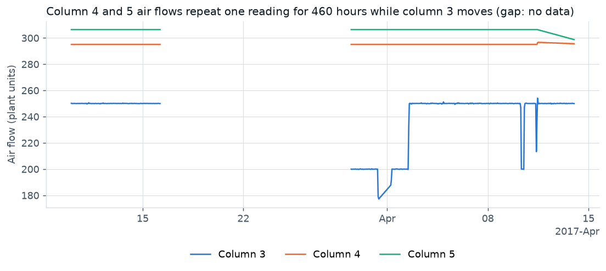
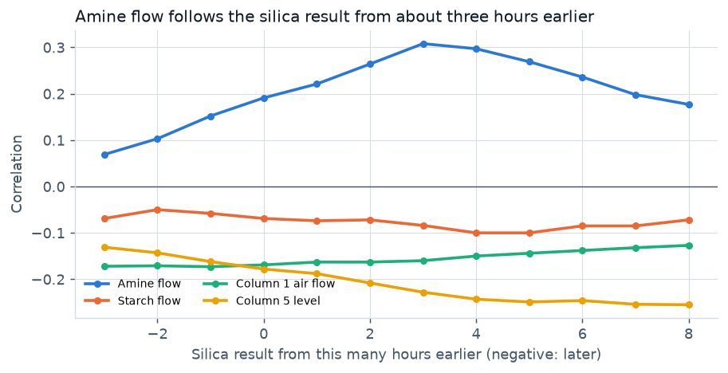
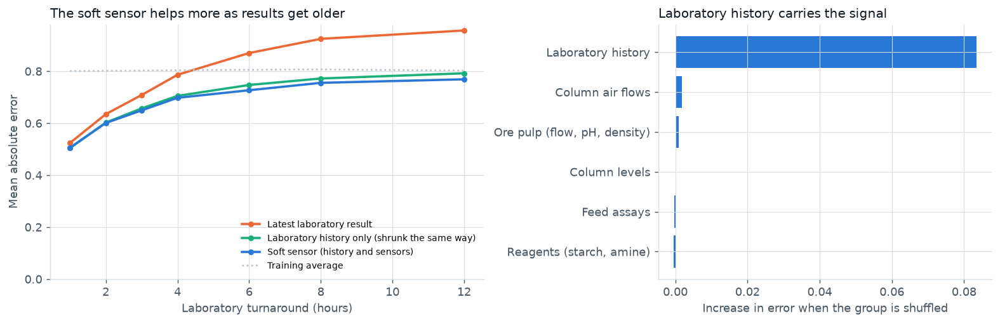
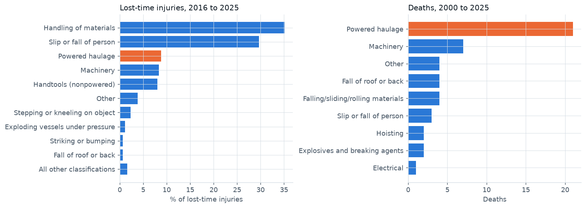
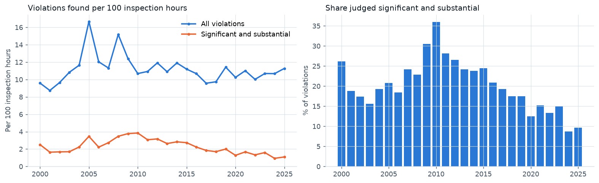

# Mine operations analytics: trusted plant data, a concentrate quality soft sensor, and gold mine safety and compliance

Onyi Chuks, Calgary, Alberta. October 2026.
[Interactive dashboard](https://onyichuks.github.io/mine-operations-analytics/) · [Executive summary](EXECUTIVE_SUMMARY.md) · [Machine learning note](ML_TECHNICAL_NOTE.md) · [About the data](DATASET.md)

## Summary

This report asks two operational questions of public mining data.

**Part A** looks at six months of 20-second process readings and hourly laboratory assays from an iron ore flotation plant (2017). Only 81 percent of the hourly silica values are confirmed as new laboratory measurements; the rest repeat the previous hour, were interpolated, or are doubtful. Two air flow sensors were frozen for 460 hours, and the feed assays change only every 9 hours. Tested the way this dataset is usually tested, a model scores R² 0.93. Tested on next month's measured hours, the process sensors alone explain nothing.

A soft sensor that combines laboratory history with the sensors beats the latest laboratory result by 5 percent with a 2-hour turnaround and by 16 percent when the result is 6 hours old. Its 80 percent ranges held 81 percent of the time. Almost all of its skill comes from the laboratory history.

**Part B** looks at United States Mine Safety and Health Administration (MSHA) records for gold mines from 2000 to 2025. The lost-time injury rate fell from 2.58 per 200,000 hours (2000) to 0.70 (2018) and has risen since, to 0.99 (2025). Injuries have also become more serious. Mills have about the same lost-time injury rate as underground mining. Powered haulage causes deaths out of all proportion to its share of injuries, and new workers, especially contractors, are over-represented.

A model of next-year injury rates shows that a mine's own recent injury rate is a weak but useful signal. Inspection and violation records add nothing to it.

## 1. Questions and approach

| | Question | Benchmark the answer must beat | Test |
|---|---|---|---|
| A1 | Can the plant data be trusted? | | Audit of sampling, gaps, stuck sensors and how each laboratory value was produced |
| A2 | Can silica in concentrate be estimated before the laboratory result arrives? | The latest laboratory result that has arrived | Monthly rolling test, June to September 2017, on measured hours only |
| B1 | Where do injuries at gold mines come from? | | Rates per 200,000 hours, 2000 to 2025, by year, part of the mine and cause |
| B2 | Which mines will have the highest injury rate next year, and do inspection records help? | Last year's industry rate; the mine's own recent rate | Yearly rolling test, 2016 to 2025, 769 mine-years |

Both parts follow the same rule: check the data first, then compare every model with the simple method an operation already uses, on data the model never saw.

## 2. Data

Full details and checks are in [About the data](DATASET.md).

* **Plant:** OpenML dataset 43311, "Quality Prediction in a Mining Process" (CC0 public domain dedication). 737,453 readings at 20-second intervals, 10 March to 9 September 2017. It covers starch and amine flow, ore pulp flow, pH and density, and air flow and froth level in seven flotation columns, with feed assays and hourly laboratory assays of iron and silica in the concentrate.
* **Safety:** MSHA Open Government Data (public domain), downloaded 27 October 2026. Five files: mines, employee hours by mine and year, accident reports, inspections and violations. They are filtered to the 3,024 mines whose primary product is gold ore; most are abandoned, and 589 reported employee hours in 2000 to 2025 (about 150 in a typical year).

---

# Part A. The processing plant

## 3. Can the data be trusted?

### 3.1 How each silica value was produced

The silica assay is a laboratory result for an hourly sample, but the file repeats it on all 180 rows of the hour. Looking at the values hour by hour shows four kinds:

| Kind of hour | Hours | Share | What it means |
|---|---:|---:|---|
| Measured | 3,323 | 81.1% | A new value, constant through the hour |
| Repeat | 446 | 10.9% | The same value as the hour before (a result carried forward) |
| Varies within hour | 310 | 7.6% | The value changes from row to row: interpolated at 20-second steps |
| Straight-line fill | 18 | 0.4% | The hour sits exactly on a line between its neighbours |
| Missing | 318 | | A 13-day gap, 16 to 29 March, with no data at all |


The interpolated hours come in 84 runs. Most are short (36 are single hours), but five run for 12 hours or more, the longest for 27 hours.

The 18 straight-line hours are all isolated, with measured hours on both sides. With values recorded to two decimals, equal steps happen by chance about this often, so these may be real results. They are left out to be safe; counting them would raise the measured share from 81.1 to 81.5 percent.

Only measured hours are used to train or score the soft sensor, and only measured results are used as its laboratory history. An interpolated value at 10:00 may have been computed from a result that arrived at 14:00, so using it as history would leak the future into the inputs.

### 3.2 Stuck sensors, frozen data and duplicates

* **Two stuck sensors.** The air flows of columns 4 and 5 repeat exactly the same reading (295.096 and 306.400) for 460 hours of data, from the first record to 11 April 11:00. The other five columns move normally. These values are blanked.
* **A stalled feed.** In eight hours on 28 June, 11 July and 13 July the data feed stalled: almost every sensor froze, or a quarter or more of the rows are exact copies of earlier rows. These hours hold 1,049 of the 1,171 duplicated rows and are blanked.
* **Feed assays are not hourly.** Iron and silica in the feed change every 9 hours (median), so they behave like shift composites, not hourly measurements.
* **No values outside physical limits,** and two incomplete hours (174 and 179 rows).



### 3.3 Leakage: why this dataset looks easy

Iron and silica in the concentrate come from the same laboratory sample, with a correlation of -0.80. Many published analyses of this dataset use iron as an input and shuffle 20-second rows into training and test sets. That puts near-identical rows from the same hour on both sides. The table shows how much each shortcut adds:

| How it was tested | R² | Mean absolute error |
|---|---:|---:|
| Random split of 20-second rows, iron in concentrate included | 0.93 | 0.212 |
| Random split of 20-second rows, iron removed | 0.72 | 0.435 |
| Random split of measured hours, process sensors only | 0.21 | 0.692 |
| Next month, measured hours, process sensors only | -0.03 | 0.749 |
| Next month, latest laboratory result | 0.00 | 0.635 |
| Next month, soft sensor (laboratory history and sensors) | 0.17 | 0.601 |
| Next month, soft sensor, repeated and interpolated hours treated as measured | 0.34 | 0.553 |


Rows four to six are the tests that mirror how a model would be used. On them, the process sensors alone are barely better than the average silica, and the latest laboratory result is the benchmark to beat. The last row shows the cost of skipping the audit in section 3.1: training and scoring the same soft sensor with filled-in hours treated as measurements doubles its R².

## 4. Plant performance indicators

Silica in concentrate averaged 2.19 percent on measured hours (median 1.87, 90th percentile 3.81, maximum 5.53). Iron in concentrate averaged 65.2 percent, from feed at 56.3 percent iron and 14.7 percent silica.

Off-specification here means silica above 3 percent. That limit is an assumption for illustration (about the 81st percentile of measured hours); plants set their own by contract. On that basis, 19.4 percent of measured hours were off specification.

| Month (2017) | Measured hours | Silica mean (%) | Silica, 90th percentile (%) | Off specification (%) | Iron in concentrate (%) | Silica in feed (%) |
|---|---:|---:|---:|---:|---:|---:|
| March | 179 | 2.54 | 4.39 | 31.8 | 65.56 | 11.2 |
| April | 520 | 2.44 | 4.04 | 26.3 | 65.18 | 15.9 |
| May | 614 | 2.29 | 4.04 | 24.9 | 65.21 | 10.7 |
| June | 642 | 2.00 | 3.12 | 11.4 | 65.34 | 12.9 |
| July | 623 | 1.95 | 3.20 | 13.0 | 65.44 | 16.1 |
| August | 566 | 2.15 | 3.88 | 17.8 | 64.95 | 17.9 |
| September (to the 9th) | 179 | 2.43 | 4.00 | 23.5 | 64.53 | 17.0 |

Quality improved from spring to midsummer and slipped again in August and September, when silica in the feed was also higher (17 to 18 percent). The two moved together in those months, but feed silica does not explain quality in general: July had 16.1 percent feed silica and the lowest mean silica in concentrate (1.95 percent), and off-specification hours had almost the same feed silica as the rest (standardized difference +0.08). Recovery cannot be calculated because the dataset has no tailings assay.

### 4.1 Who reacts to whom

Off-specification hours ran with lower froth levels in columns 4, 5 and 7 (standardized differences of about -0.4) and lower air flow in columns 1 to 3. They also ran with more amine (+0.34).

The timing shows why this is not a recipe. Amine flow is more closely related to the silica result from three hours earlier (correlation 0.31) than to the current one (0.19), and column levels keep falling for several hours after a high result. Operators appear to respond to the laboratory. The settings therefore carry past quality, not future quality, which is probably part of the reason the process sensors cannot predict silica on their own.



## 5. A soft sensor for silica

### 5.1 Set-up

* **Unit.** One row per measured hour; the target is the laboratory silica result.
* **Turnaround.** The result for hour t reaches the control room some hours later. The central case assumes 2 hours, and results are reported for 1 to 12 hours.
* **Inputs.** For each sensor: hourly mean, spread, one-hour change and three-hour mean. Also the feed assays and the laboratory history already available: the latest result, the mean of the measured results in the last six available hours, the age of the latest result and the latest change. Iron in concentrate is never an input.
* **Model.** Gradient boosting predicts the change from the latest result. The estimate is the latest result plus a share of that change, with the share chosen on the previous month.
* **Range.** An 80 percent range from split conformal prediction, calibrated on the previous month.
* **Test.** Retrained each month on all earlier months, scored on June, July, August and September (1,996 measured hours). Hyperparameters were chosen on May, before any test month.

Details are in the [machine learning note](ML_TECHNICAL_NOTE.md).

### 5.2 Results

| Model, 2-hour turnaround | Mean absolute error | R² |
|---|---:|---:|
| Latest laboratory result | 0.635 | 0.00 |
| Training average | 0.802 | -0.07 |
| Ridge regression, process sensors only | 0.778 | -0.11 |
| Gradient boosting, process sensors only | 0.749 | -0.03 |
| Gradient boosting, laboratory history only | 0.610 | 0.25 |
| Gradient boosting, history and sensors | 0.618 | 0.23 |
| Laboratory history only, shrunk toward the latest result | 0.602 | 0.16 |
| **Soft sensor (history and sensors, shrunk)** | **0.601** | 0.17 |

The soft sensor's error was 5.4 percent lower than the latest result's. It beat the latest result in every test month:

| Month | Latest result | Soft sensor | 80% range coverage |
|---|---:|---:|---:|
| June | 0.551 | 0.535 | 87% |
| July | 0.697 | 0.651 | 74% |
| August | 0.626 | 0.590 | 85% |
| September | 0.751 | 0.699 | 73% |
| All | 0.635 | 0.601 | 81% |


### 5.3 The soft sensor helps most when results are late

| Turnaround (hours) | Latest result | Laboratory history only (shrunk) | Soft sensor | Gain over latest result | What the sensors add |
|---:|---:|---:|---:|---:|---:|
| 1 | 0.524 | 0.504 | 0.506 | 3.5% | -0.3% |
| 2 | 0.635 | 0.602 | 0.601 | 5.4% | 0.2% |
| 3 | 0.709 | 0.657 | 0.649 | 8.3% | 1.2% |
| 4 | 0.786 | 0.705 | 0.698 | 11.3% | 1.1% |
| 6 | 0.870 | 0.747 | 0.727 | 16.5% | 2.7% |
| 8 | 0.925 | 0.772 | 0.755 | 18.3% | 2.2% |
| 12 | 0.957 | 0.792 | 0.769 | 19.6% | 2.9% |

"What the sensors add" compares the soft sensor with a history-only model shrunk the same way.



1. **The latest result is hard to beat when it is fresh.** Cutting the turnaround from 2 hours to 1 reduces its error by 17 percent, more than the soft sensor adds at 2 hours.
2. **The soft sensor is worth running when results are old,** for example on a late shift or during a laboratory outage. After 6 hours it is 16 percent better.
3. **The laboratory history carries almost all of the signal.** Shuffling the history the model uses raises the error by 0.08; shuffling any group of process sensors changes it by less than 0.01. Like for like, the sensors add nothing at 1 to 2 hours and 2 to 3 percent at 6 to 12 hours.

The 80 percent ranges held 80 to 82 percent of the time at every turnaround.

### 5.4 Off-specification warning

A classifier for "silica above 3 percent this hour" ranks hours no better than the latest result itself (area under the receiver operating characteristic curve 0.74 against 0.76). From the process sensors alone the area is 0.62. At its operating point, chosen on the previous month, the classifier caught 46 percent of off-specification hours with 65 percent of warnings false. A rule on the latest result caught 58 percent with 66 percent false. There is no case for a separate warning model at this turnaround.

---

# Part B. Gold mine safety and compliance

## 6. Injury rates

Gold mines reported between 16 and 31 million employee hours a year. In 2025, 146 mines reported 27.4 million hours.

| Year | Employee hours (millions) | Mines | All injuries | Lost-time injuries | All-injury rate | Lost-time rate | Deaths (operator, contractor) |
|---|---:|---:|---:|---:|---:|---:|---|
| 2000 | 20.9 | 145 | 426 | 269 | 4.08 | 2.58 | 4, 1 |
| 2005 | 18.6 | 118 | 313 | 193 | 3.37 | 2.08 | 2, 1 |
| 2010 | 24.9 | 150 | 271 | 143 | 2.18 | 1.15 | 3, 0 |
| 2015 | 28.6 | 172 | 227 | 142 | 1.59 | 0.99 | 3, 1 |
| 2018 | 30.4 | 166 | 159 | 106 | 1.05 | 0.70 | 2, 0 |
| 2020 | 29.6 | 157 | 171 | 108 | 1.16 | 0.73 | 1, 0 |
| 2023 | 28.7 | 156 | 158 | 108 | 1.10 | 0.75 | 1, 0 |
| 2024 | 28.0 | 154 | 171 | 128 | 1.22 | 0.92 | 0, 0 |
| 2025 | 27.4 | 146 | 180 | 136 | 1.31 | 0.99 | 1, 0 |

Rates are per 200,000 hours for mine operator employees. Lost-time injuries are MSHA's non-fatal days lost (NFDL) cases. The full series is in `outputs/tables/s01_annual_injury_rates.csv`.


The lost-time rate fell by almost three quarters between 2000 and 2018 and has risen since. The rise from 2023 to 2025 is the largest two-year increase since 2011 to 2013. Contractors reported 24 percent of injuries in the last ten years, but their hours are reported by company, not by mine, so their rates cannot be calculated here.

### 6.1 By part of the mine (2016 to 2025)

| Area | Hours (millions) | Lost-time injuries | Lost-time rate | All-injury rate | Deaths (operator employees) |
|---|---:|---:|---:|---:|---:|
| Open pit | 113.0 | 559 | 0.99 | 1.36 | 4 |
| Mill or preparation plant | 67.1 | 267 | 0.80 | 1.16 | 0 |
| Underground | 58.9 | 239 | 0.81 | 1.22 | 5 |
| Office | 32.5 | 13 | 0.08 | 0.15 | 0 |
| Surface at underground mine | 16.3 | 105 | 1.29 | 1.66 | 0 |
| Other mining | 5.1 | 33 | 1.30 | 2.09 | 0 |

Underground mining used to have by far the highest rate (4.75 in 2000) and is now close to the rest. **Mills have about the same lost-time rate as underground mining,** although no mill deaths were recorded. Surface work at underground mines has the highest rate of the main areas and jumped to about 2.0 in 2024 and 2025.

## 7. What causes injuries and deaths

| Classification (operator lost-time injuries, 2016 to 2025) | Share | Median days away or restricted | Share in mills |
|---|---:|---:|---:|
| Handling of materials | 35.1% | 18 | 42.7% |
| Slip or fall of person | 29.7% | 23 | 26.6% |
| Powered haulage | 8.8% | 14 | 1.9% |
| Machinery | 8.3% | 15 | 7.5% |
| Hand tools (non-powered) | 8.0% | 15 | 11.2% |
| Fall of roof or back | 0.7% | 121 | 0.0% |

The most common injuries are sprains and strains (44 percent) and fractures (20 percent), to the back (15 percent), fingers (15 percent) and knees (12 percent). Maintenance workers account for 25 percent of lost-time injuries, more than any other occupation.

Deaths follow a different pattern. Of the 48 deaths at gold mines from 2000 to 2025 (operators and contractors), **21 were powered haulage** (haul trucks, loaders and other mobile equipment), 7 machinery, and 4 each falls of roof or back, falling or rolling material, and other causes. Powered haulage is under a tenth of lost-time injuries but 44 percent of deaths. A safety program judged by injury counts can succeed while fatal risk stays where it was. Ten deaths occurred in the last ten years (nine operator employees and one contractor).



## 8. New workers and severity

Of the 1,496 lost-time injuries in 2016 to 2025 (operators and contractors) with experience recorded:

* **33 percent** were to workers with less than a year at the mine, and 16 percent less than three months.
* For contractors the share was **68 percent**; for mine operator employees, 25 percent.
* 20 percent had less than a year in mining at all.

The data has no count of workers by experience, so these are shares of injuries, not rates. They still point clearly to where induction, supervision and task training matter most.

Injuries have become more serious:

| Period | Lost-time injuries (operator) | Median days away or restricted | Mean days | Share over 30 days |
|---|---:|---:|---:|---:|
| 2006 to 2015 | 1,715 | 15 | 39 | 34% |
| 2016 to 2020 | 607 | 15 | 45 | 32% |
| 2021 to 2025 | 609 | 24 | 57 | 46% |

This could mean more serious injuries, or changes in how cases are managed and how long workers stay on restricted duty. Either way it raises the cost of each injury.

## 9. Inspections and violations

MSHA must inspect each surface mine at least twice a year and each underground mine four times. In 2016 to 2025, regular inspections were 49 percent of inspection events, hazard complaints 17 percent, follow-ups 11 percent, spot inspections 10 percent and accident investigations 4 percent.

Inspectors found about 11 violations per 100 inspection hours in 2025, and between 9.6 and 11.9 in every year since 2010. What changed is how serious they were judged. The share marked significant and substantial (reasonably likely to cause a reasonably serious injury) peaked at 36 percent in 2010. Since 2018 it fell from 17.5 to 9.7 percent, while the lost-time injury rate rose from 0.70 to 0.99. The fall therefore more likely reflects a change in enforcement practice than lower risk.



| Most cited standards, 2016 to 2025 (Title 30, Code of Federal Regulations) | What it covers | Citations | Significant and substantial |
|---|---|---:|---:|
| 56.14100 | Safety defects on equipment (surface) | 908 | 17% |
| 57.3360 | Ground support use (underground) | 905 | 20% |
| 57.3200 | Correction of hazardous ground conditions | 827 | 30% |
| 57.14100 | Safety defects on equipment (underground mines) | 757 | 11% |
| 47.41 | Hazard communication: container labels | 511 | 1% |
| 57.11001 | Safe access to working places (underground mines) | 507 | 32% |
| 56.20003 | Housekeeping (surface) | 468 | 24% |
| 56.11001 | Safe access to working places (surface) | 422 | 37% |
| 56.12004 | Electrical conductors | 404 | 6% |
| 56.12028 | Testing grounding systems | 393 | 7% |

Part 56 covers surface mines, and Part 57 covers underground mines including their surface areas. The citations match the injury and fatality patterns: equipment defects (powered haulage and machinery), ground conditions (falls of roof or back), and safe access and housekeeping (slips and falls). Safe access and ground conditions are also the citations most often judged significant and substantial.

## 10. Which mines will have the highest injury rate next year?

### 10.1 Set-up

* **Unit.** Each row is a mine and a year, for mines with at least 10,000 employee hours that year (about five full-time workers) and some hours the next year.
* **Inputs**, from that year and earlier:
  * size and workforce mix: hours, employees, growth, and shares of underground, mill and open pit hours;
  * injury history: lost-time and all injuries, medical-only cases, contractor injuries, injuries to new workers, days lost, the previous year and three-year totals, and the mine's rate relative to the industry;
  * inspections and violations: violations, significant and substantial violations, orders, high negligence, penalties, inspection hours, complaint inspections, and violations per 100 inspection hours.
* **Target.** Next year's lost-time injuries, with next year's hours as exposure (a Poisson rate model).
* **Industry trend.** Rates fell steeply over the period, so each mine's rate is expressed against the industry rate of the same year. Predictions are scaled by the latest industry rate known when the prediction is made, last year's.
* **Test.** Retrained each year on all earlier years, scored on 2016 to 2025: 769 mine-years with 1,191 lost-time injuries.
* **Skill.** The share of Poisson deviance explained beyond giving every mine last year's industry rate. A score of 0 means no better than that baseline.

### 10.2 Results

| Model | Skill | Top fifth of mines: rate against average |
|---|---:|---:|
| Last year's industry rate (baseline) | 0.0% | |
| Mine's own three-year rate relative to the industry, shrunk | 10.1% | 1.65 times |
| Poisson regression: size, mix and injury history | 14.6% | 1.95 times |
| Poisson regression: all inputs | 14.9% | 2.08 times |
| **Gradient boosting: size, mix and injury history** | **13.3%** | 1.79 times |
| Gradient boosting: all inputs | 13.2% | 1.82 times |


* **History is a weak but useful signal.** A simple rule explains 10 percent: the mine's injuries over three years, divided by the number expected at industry rates and pulled toward one by the weight of one expected injury. Poisson regression and gradient boosting reach 13 to 15 percent. Boosting's gain over the simple rule is 3.2 points, with a 90 percent interval of -1.6 to +7.9 from resampling whole mines.
* **Inspection and violation records add nothing.** Adding them changes the boosting model's skill by 0.0 points (interval -1.9 to +2.1) and the Poisson regression's by +0.3 (-0.8 to +1.5). A model trained with them leans on them a little (shuffling them costs 2.1 points), but a model trained without them does just as well. Shuffling injury history costs 29.2 points and size and mix 6.8.
* **The ranking is useful, the predicted values less so.** In the boosting model's ranking, mines in the highest fifth had an observed rate of 1.47, against 0.49 in the lowest fifth. The top band was predicted at 1.80, too high, so read the model as a ranking. The Poisson regression has slightly higher skill but ranks small mines highest: its top fifth worked 6 percent of hours, against 14 percent for boosting.
* **The signal is unstable.** For boosting with injury history, skill ranged from -6 to +45 percent by year and was below the baseline in 2019, 2022 and 2025. In 2025 the third of mines with the best records had 2.2 times the rate the simple rule predicted (0.89 against 0.40, weighted by hours), while the third with the worst records came in below theirs (1.26 against 1.58). A ranking like this should be refitted every year and its skill tracked.

## 11. What it means

1. **Audit plant data before modelling it.** Flag repeated, interpolated and frozen values where the data is stored, and score models only on real measurements. The checks in `plant_quality.py` run in seconds and would belong in any plant data pipeline.
2. **Judge a soft sensor against the latest laboratory result.** Here it is worth deploying for hours when results are late, not as a replacement for the laboratory.
3. **Invest where the signal is.** The process sensors say little about silica on their own. An online analyzer or faster laboratory turnaround would do more than a more complex model.
4. **Treat fatal risk separately from injury counts.** Powered haulage and machinery need traffic management, proximity detection, guarding and lockout controls, even though they are a small share of injuries. The most cited standards point at the same hazards.
5. **Focus on the first year at a mine,** especially for contractors.
6. **Rank mines by their own recent injury rate, relative to the industry, to decide where to look first.** Refit the ranking every year, track how well it ranks, and do not use citation counts as a leading indicator.

## 12. Limits

* The plant data is one anonymous plant over six months. Flow units are undocumented, and the laboratory turnaround is an assumption.
* The 3 percent limit is illustrative, and recovery cannot be calculated without a tailings assay.
* Associations between settings and quality run both ways, because operators react to results.
* Safety rates cover operator employees only. Injury counts depend on reporting, and days lost depend on case management as well as severity.
* Violation counts depend on how often and how long inspectors visit. The rate model is a screening tool, not a causal estimate.

## 13. Reproducing the results

```
pip install -r requirements.txt
python scripts/get_data.py          # about 330 megabytes
python scripts/prepare_data.py
python run_plant.py
python run_safety.py
python scripts/build_dashboard.py
python scripts/make_figures.py
pytest
```

MSHA refreshes its files weekly, so a fresh download will move the safety numbers slightly. The OpenML file is fixed and checked against its checksum.

## References

* Mine Safety and Health Administration. Open Government Data sets and definition files. https://arlweb.msha.gov/OpenGovernmentData/OGIMSHA.asp
* Mine Safety and Health Administration. Mine Injury and Worktime, Quarterly, fourth quarter 2025 (incidence rates per 200,000 employee hours). https://arlweb.msha.gov/Stats/Part50/WQ/2025/MIWQ%20-%20CY2025Q4.pdf
* National Institute for Occupational Safety and Health (NIOSH). Methods for mining statistics (lost-time injuries as degree codes 2 to 5). https://www.cdc.gov/niosh/mining/data-stats/methodology.html
* OpenML dataset 43311, Quality Prediction in a Mining Process. https://www.openml.org/d/43311
* Angelopoulos, A. N. and Bates, S. (2023). Conformal prediction: a gentle introduction. Foundations and Trends in Machine Learning, 16(4).
* Federal Mine Safety and Health Act of 1977, section 103(a) (inspection frequency).
